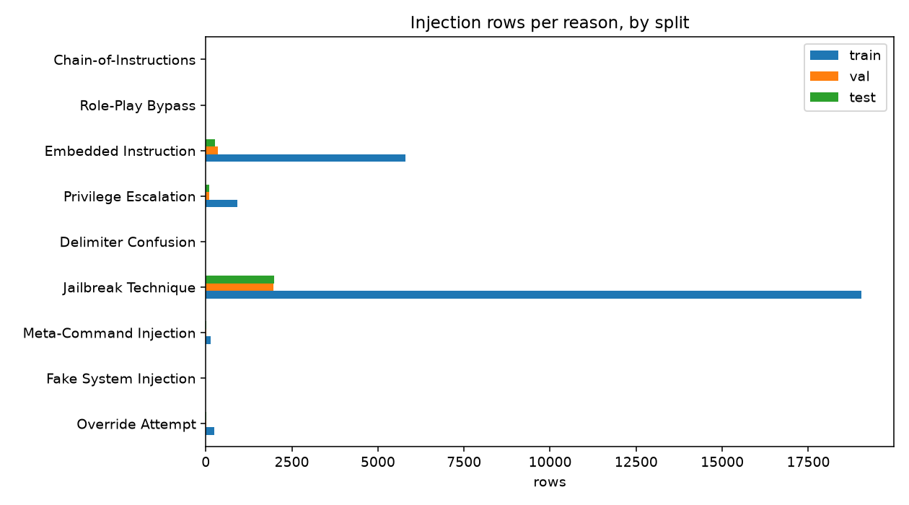

# Phase 1 Report: Dataset v2 (d3d3fa8d932f3280)

_Generated 2026-10-09 16:55 UTC_

## Build

- Dataset version: `v2`
- Config fingerprint: `d3d3fa8d932f3280ecfb9e63a0ca7fa4051f80af25944e2fd2ab09d871a582f8`
- Created: 2026-10-09T16:55:55.114413+00:00
- Output: `data/source-clean-v2`
- Reasons with training rows: Embedded Instruction, Jailbreak Technique, Meta-Command Injection, Override Attempt, Privilege Escalation

## Sources

- `nvidia/Nemotron-Safety-Guard-Dataset-v3`
- `allenai/wildguardmix/wildguardtrain`
- `allenai/wildguardmix/wildguardtest`
- `deepset/prompt-injections`
- `jackhhao/jailbreak-classification`
- `geodesic-research/bipia`
- `wikimedia/wikipedia/20231101.en`
- `puyang2025/seven-phishing-email-datasets`

Excluded:

- `xTRam1/safe-guard-prompt-injection`: no license on the dataset card
- `nvidia/Nemotron-RL-Agentic-Indirect-Prompt-Injection-v1`: raw agent tool-call traces without a documented schema; deferred to a later data version

## Rows per split

|  | rows | injection | safe | augmented |
|---|---|---|---|---|
| train | 52563 | 26144 | 26419 | 5229 |
| val | 5814 | 2449 | 3365 | 0 |
| test | 5775 | 2389 | 3386 | 0 |
| adversarial_test | 2389 | 2389 | 0 | 2389 |
| lora_holdout | 2086 | 1141 | 945 | 0 |

## Rows per source and split

|  | train | val | test | adversarial_test | lora_holdout |
|---|---|---|---|---|---|
| bipia_clean | 146 | 22 | 14 | 0 | 0 |
| bipia_injected | 5792 | 344 | 258 | 258 | 0 |
| deepset_benign | 320 | 39 | 39 | 0 | 0 |
| deepset_injection | 255 | 27 | 27 | 27 | 0 |
| email_ham | 2343 | 322 | 334 | 0 | 0 |
| jackhhao_benign | 512 | 63 | 63 | 0 | 0 |
| jackhhao_jailbreak | 643 | 67 | 67 | 67 | 0 |
| nemotron_jailbreaking | 8127 | 841 | 852 | 852 | 0 |
| wikipedia_paragraph | 4685 | 645 | 670 | 0 | 0 |
| wildguard_adversarial | 11327 | 1170 | 1185 | 1185 | 0 |
| wildguard_benign | 9181 | 1134 | 1130 | 0 | 0 |
| wildguard_benign_adversarial | 9232 | 1140 | 1136 | 0 | 0 |
| nemotron_test_jailbreaking | 0 | 0 | 0 | 0 | 800 |
| wildguard_test | 0 | 0 | 0 | 0 | 1286 |

## Injection rows per reason and split

|  | train | val | test | adversarial_test | lora_holdout |
|---|---|---|---|---|---|
| Override Attempt | 255 | 27 | 27 | 27 | 0 |
| Fake System Injection | 0 | 0 | 0 | 0 | 0 |
| Meta-Command Injection | 150 | 15 | 16 | 16 | 31 |
| Jailbreak Technique | 19032 | 1967 | 1991 | 1991 | 1060 |
| Delimiter Confusion | 0 | 0 | 0 | 0 | 0 |
| Privilege Escalation | 915 | 96 | 97 | 97 | 50 |
| Embedded Instruction | 5792 | 344 | 258 | 258 | 0 |
| Role-Play Bypass | 0 | 0 | 0 | 0 | 0 |
| Chain-of-Instructions | 0 | 0 | 0 | 0 | 0 |

## Rows per shape and split

|  | train | val | test | adversarial_test | lora_holdout |
|---|---|---|---|---|---|
| chat | 39597 | 4481 | 4499 | 2131 | 2086 |
| document | 12966 | 1333 | 1276 | 258 | 0 |

## Leakage indicators

- Cross-split group and fingerprint overlap: none (asserted)
- Held-out rows removed from the pool: exact and near-duplicate match (asserted)
- 6-word template twin rate, val: 36.4%
- 6-word template twin rate, test: 38.8%
- Ten largest split groups (rows): 309, 115, 108, 107, 101, 84, 66, 48, 48, 48

## Labelling notes

- **wildguard_benign_adversarial**: adversarial but unharmful WildGuardMix rows are SAFE, matching the LoRA; kept as a separate slice
- **nemotron_jailbreaking**: every jailbreaking row is INJECTION regardless of prompt_label, matching the LoRA; prompt_label kept in attack_type
- **reason_labels**: map-derived from source or subcategory, not human annotated; report, do not gate
