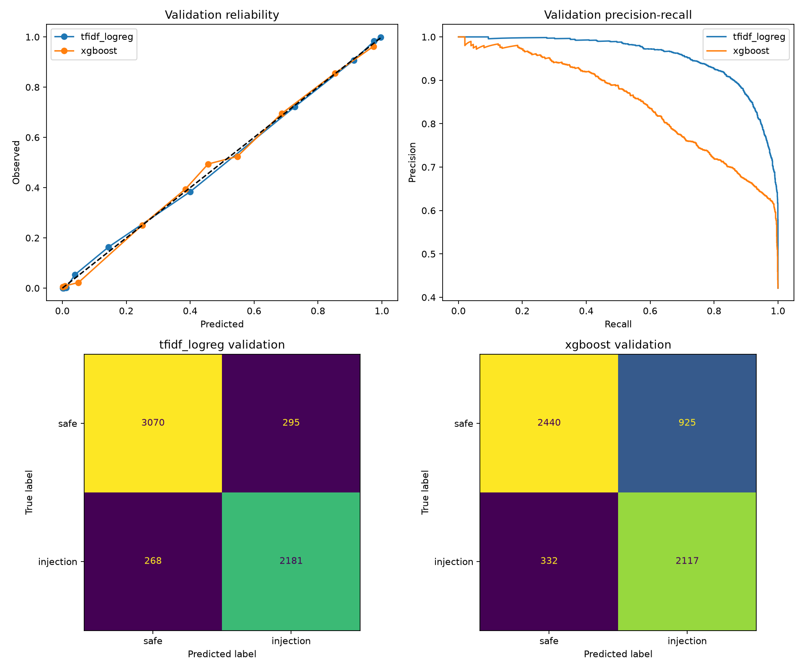
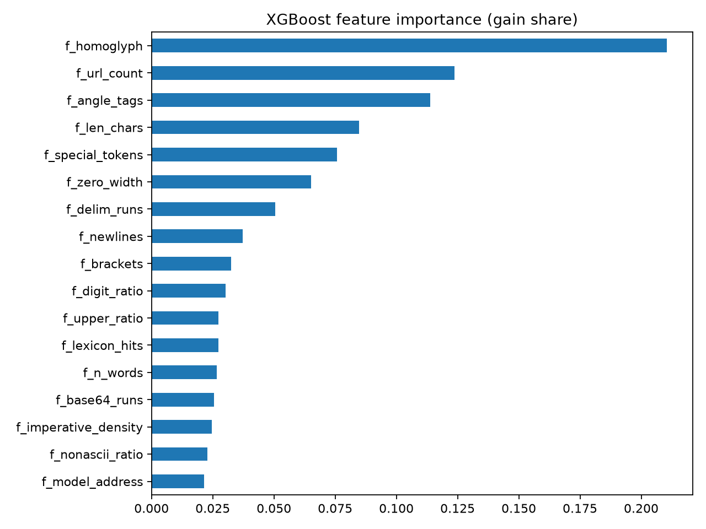

# Phase 2 Report: Baselines on dataset v2 (d3d3fa8d932f3280)

_Generated 2026-10-09 16:57 UTC_

## Run

- Run ID: `phase2-v2-d3d3fa8d932f3280`
- Dataset fingerprint: `d3d3fa8d932f3280ecfb9e63a0ca7fa4051f80af25944e2fd2ab09d871a582f8`
- Chosen baseline (val F1, recall, FPR): **tfidf_logreg**
- XGBoost best iteration: 786 (early stopping fired)
- Device: cuda, torch 2.10.0a0+b558c986e8.nv25.11, xgboost 3.4.0
- Artifacts: `models/phase2-v2-d3d3fa8d932f3280`

## Validation (selection data)

|  | threshold | precision | recall | f1 | roc_auc | average_precision | brier | log_loss | false_positive_rate |
|---|---|---|---|---|---|---|---|---|---|
| tfidf_logreg | 0.4787 | 0.8809 | 0.8906 | 0.8857 | 0.9667 | 0.9554 | 0.0716 | 0.2314 | 0.0877 |
| xgboost | 0.4040 | 0.6959 | 0.8644 | 0.7711 | 0.8894 | 0.8498 | 0.1323 | 0.3970 | 0.2749 |

## Locked test

|  | threshold | precision | recall | f1 | roc_auc | average_precision | brier | log_loss | false_positive_rate |
|---|---|---|---|---|---|---|---|---|---|
| tfidf_logreg | 0.4787 | 0.8986 | 0.9129 | 0.9057 | 0.9769 | 0.9665 | 0.0573 | 0.1929 | 0.0727 |
| xgboost | 0.4040 | 0.6931 | 0.8610 | 0.7680 | 0.8968 | 0.8586 | 0.1281 | 0.3821 | 0.2690 |

95% bootstrap intervals (1,000 resamples):

|  | average_precision | roc_auc | f1 | recall | false_positive_rate |
|---|---|---|---|---|---|
| tfidf_logreg | 0.9611 to 0.9714 | 0.9738 to 0.9799 | 0.8973 to 0.9138 | 0.9015 to 0.9241 | 0.0642 to 0.0807 |
| xgboost | 0.8459 to 0.8707 | 0.8894 to 0.9043 | 0.7544 to 0.7806 | 0.8462 to 0.8743 | 0.2547 to 0.2838 |

## Recall at FPR budget (test)

|  | fpr_0.01 | fpr_0.005 | fpr_0.001 |
|---|---|---|---|
| tfidf_logreg | 0.6208 | 0.4923 | 0.2687 |
| xgboost | 0.3185 | 0.2520 | 0.1415 |

## Test slices by shape

|  | rows | recall | false_positive_rate | f1 |
|---|---|---|---|---|
| ('tfidf_logreg', 'chat') | 4499.0000 | 0.9024 | 0.0971 | 0.8978 |
| ('tfidf_logreg', 'document') | 1276.0000 | 1.0000 | 0.0157 | 0.9699 |
| ('xgboost', 'chat') | 4499.0000 | 0.8475 | 0.3264 | 0.7669 |
| ('xgboost', 'document') | 1276.0000 | 0.9729 | 0.1356 | 0.7759 |

## Test slices by source

|  | rows | recall | false_positive_rate | f1 |
|---|---|---|---|---|
| ('tfidf_logreg', 'bipia_clean') | 14.0000 |  | 1.0000 |  |
| ('tfidf_logreg', 'bipia_injected') | 258.0000 | 1.0000 |  |  |
| ('tfidf_logreg', 'deepset_benign') | 39.0000 |  | 0.0256 |  |
| ('tfidf_logreg', 'deepset_injection') | 27.0000 | 0.7407 |  |  |
| ('tfidf_logreg', 'email_ham') | 334.0000 |  | 0.0000 |  |
| ('tfidf_logreg', 'jackhhao_benign') | 63.0000 |  | 0.0159 |  |
| ('tfidf_logreg', 'jackhhao_jailbreak') | 67.0000 | 0.8806 |  |  |
| ('tfidf_logreg', 'nemotron_jailbreaking') | 852.0000 | 0.9660 |  |  |
| ('tfidf_logreg', 'wikipedia_paragraph') | 670.0000 |  | 0.0030 |  |
| ('tfidf_logreg', 'wildguard_adversarial') | 1185.0000 | 0.8616 |  |  |
| ('tfidf_logreg', 'wildguard_benign') | 1130.0000 |  | 0.0053 |  |
| ('tfidf_logreg', 'wildguard_benign_adversarial') | 1136.0000 |  | 0.1954 |  |
| ('xgboost', 'bipia_clean') | 14.0000 |  | 0.7857 |  |
| ('xgboost', 'bipia_injected') | 258.0000 | 0.9729 |  |  |
| ('xgboost', 'deepset_benign') | 39.0000 |  | 0.1026 |  |
| ('xgboost', 'deepset_injection') | 27.0000 | 0.3333 |  |  |
| ('xgboost', 'email_ham') | 334.0000 |  | 0.0719 |  |
| ('xgboost', 'jackhhao_benign') | 63.0000 |  | 0.3016 |  |
| ('xgboost', 'jackhhao_jailbreak') | 67.0000 | 0.9701 |  |  |
| ('xgboost', 'nemotron_jailbreaking') | 852.0000 | 0.9225 |  |  |
| ('xgboost', 'wikipedia_paragraph') | 670.0000 |  | 0.1537 |  |
| ('xgboost', 'wildguard_adversarial') | 1185.0000 | 0.7983 |  |  |
| ('xgboost', 'wildguard_benign') | 1130.0000 |  | 0.0416 |  |
| ('xgboost', 'wildguard_benign_adversarial') | 1136.0000 |  | 0.6188 |  |

## Locked adversarial test

|  | threshold | injection_recall | probability_mean | probability_median | probability_min | probability_max |
|---|---|---|---|---|---|---|
| tfidf_logreg | 0.4787 | 0.9665 | 0.9204 | 0.9841 | 0.0173 | 1.0000 |
| xgboost | 0.4040 | 0.9661 | 0.9022 | 0.9852 | 0.0093 | 1.0000 |

By variant kind:

|  | rows | recall |
|---|---|---|
| ('tfidf_logreg', 'case_noise') | 471.0000 | 0.9851 |
| ('tfidf_logreg', 'delimiter_wrap') | 456.0000 | 0.9956 |
| ('tfidf_logreg', 'homoglyph') | 472.0000 | 0.9915 |
| ('tfidf_logreg', 'whitespace_noise') | 489.0000 | 0.9141 |
| ('tfidf_logreg', 'zero_width') | 501.0000 | 0.9501 |
| ('xgboost', 'case_noise') | 471.0000 | 0.9766 |
| ('xgboost', 'delimiter_wrap') | 456.0000 | 0.9934 |
| ('xgboost', 'homoglyph') | 472.0000 | 1.0000 |
| ('xgboost', 'whitespace_noise') | 489.0000 | 0.9611 |
| ('xgboost', 'zero_width') | 501.0000 | 0.9042 |

## Plots

