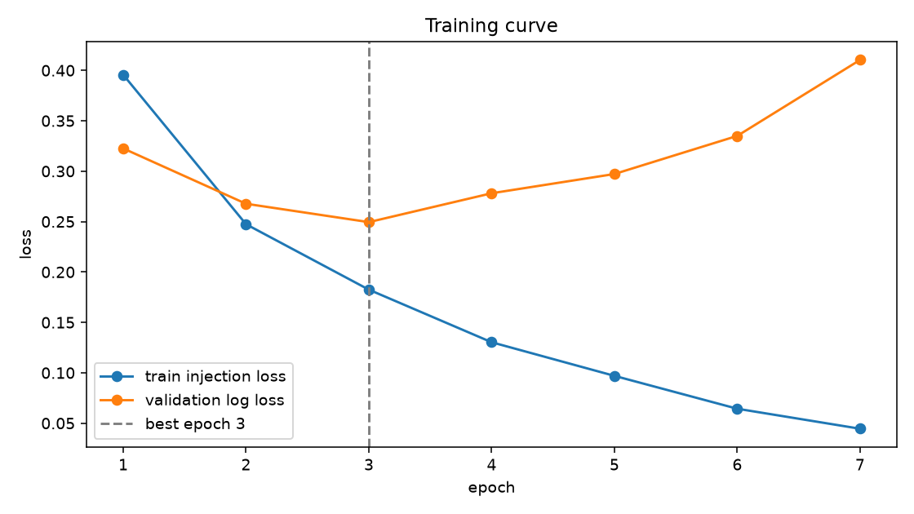

# Phase 3 Report: CNN + BiGRU on dataset v2 (d3d3fa8d932f3280)

_Generated 2026-10-09 17:04 UTC_

## Run

- Run ID: `phase3-cnn-bigru-v2-d3d3fa8d932f3280`
- Dataset fingerprint: `d3d3fa8d932f3280ecfb9e63a0ca7fa4051f80af25944e2fd2ab09d871a582f8`
- Parameters: 6,681,610; weights on disk: 26.7 MB
- Config: vocab 50,000, 512 tokens, embedding 128, hidden 128, cnn 128, dropout 0.25, batch 256, lr 0.002, reason loss weight 0.5
- Best epoch 3 of 7 run (patience 4); threshold 0.4330 by validation F1
- Device: cuda, bf16 True, torch 2.10.0a0+b558c986e8.nv25.11
- Artifacts: `models/phase3-cnn-bigru-v2-d3d3fa8d932f3280`

## Training curve

|  | train_loss | train_injection_loss | train_reason_loss | validation_log_loss | validation_reason_accuracy_on_positives | seconds |
|---|---|---|---|---|---|---|
| 1 | 0.5374 | 0.3956 | 0.2836 | 0.3226 | 0.9465 | 33.7000 |
| 2 | 0.3203 | 0.2474 | 0.1458 | 0.2677 | 0.9514 | 33.3000 |
| 3 | 0.2391 | 0.1825 | 0.1132 | 0.2495 | 0.9543 | 33.2000 |
| 4 | 0.1747 | 0.1303 | 0.0887 | 0.2781 | 0.9612 | 33.3000 |
| 5 | 0.1274 | 0.0970 | 0.0610 | 0.2972 | 0.9510 | 33.6000 |
| 6 | 0.0880 | 0.0643 | 0.0473 | 0.3350 | 0.9575 | 33.3000 |
| 7 | 0.0615 | 0.0445 | 0.0339 | 0.4103 | 0.9551 | 33.4000 |

## Headline metrics

|  | threshold | precision | recall | f1 | roc_auc | average_precision | brier | log_loss | false_positive_rate |
|---|---|---|---|---|---|---|---|---|---|
| validation | 0.4330 | 0.8588 | 0.8718 | 0.8652 | 0.9613 | 0.9487 | 0.0802 | 0.2495 | 0.1043 |
| test | 0.4330 | 0.8854 | 0.8832 | 0.8843 | 0.9704 | 0.9605 | 0.0675 | 0.2167 | 0.0806 |

95% bootstrap intervals on test (1,000 resamples):

|  | average_precision | roc_auc | f1 | recall | false_positive_rate |
|---|---|---|---|---|---|
| test | 0.9552 to 0.9654 | 0.9669 to 0.9736 | 0.8749 to 0.8935 | 0.8708 to 0.8969 | 0.0719 to 0.0890 |

## Recall at FPR budget (test)

|  | recall | threshold | achieved_fpr |
|---|---|---|---|
| fpr_0.01 | 0.6287 | 0.8977 | 0.0097 |
| fpr_0.005 | 0.5479 | 0.9511 | 0.0047 |
| fpr_0.001 | 0.3771 | 0.9887 | 0.0009 |

## Test slices by shape

|  | rows | recall | false_positive_rate | f1 |
|---|---|---|---|---|
| chat | 4499.0000 | 0.8691 | 0.1094 | 0.8732 |
| document | 1276.0000 | 1.0000 | 0.0138 | 0.9736 |

## Test slices by source

|  | rows | recall | false_positive_rate | f1 |
|---|---|---|---|---|
| bipia_clean | 14.0000 |  | 0.4286 |  |
| bipia_injected | 258.0000 | 1.0000 |  |  |
| deepset_benign | 39.0000 |  | 0.0000 |  |
| deepset_injection | 27.0000 | 0.5556 |  |  |
| email_ham | 334.0000 |  | 0.0000 |  |
| jackhhao_benign | 63.0000 |  | 0.0952 |  |
| jackhhao_jailbreak | 67.0000 | 0.9104 |  |  |
| nemotron_jailbreaking | 852.0000 | 0.9695 |  |  |
| wikipedia_paragraph | 670.0000 |  | 0.0119 |  |
| wildguard_adversarial | 1185.0000 | 0.8017 |  |  |
| wildguard_benign | 1130.0000 |  | 0.0097 |  |
| wildguard_benign_adversarial | 1136.0000 |  | 0.2130 |  |

## Reason head on test true positives

- Rows: 2110; accuracy 0.9540284360189574; top-2 accuracy 0.9943127962085309; macro-F1 over defined reasons 0.6794381369133685
- Reasons with training rows: Embedded Instruction, Jailbreak Technique, Meta-Command Injection, Override Attempt, Privilege Escalation

|  | support | predicted | precision | recall | status |
|---|---|---|---|---|---|
| Override Attempt | 15 | 13 | 0.8462 | 0.7333 | defined |
| Fake System Injection | 0 | 0 |  |  | undefined: no training rows |
| Meta-Command Injection | 12 | 1 | 1.0000 | 0.0833 | defined |
| Jailbreak Technique | 1743 | 1759 | 0.9687 | 0.9776 | defined |
| Delimiter Confusion | 0 | 0 |  |  | undefined: no training rows |
| Privilege Escalation | 82 | 79 | 0.4937 | 0.4756 | defined |
| Embedded Instruction | 258 | 258 | 1.0000 | 1.0000 | defined |
| Role-Play Bypass | 0 | 0 |  |  | undefined: no training rows |
| Chain-of-Instructions | 0 | 0 |  |  | undefined: no training rows |

## Locked adversarial test

|  | threshold | injection_recall | probability_mean | probability_median | probability_min | probability_max |
|---|---|---|---|---|---|---|
| adversarial_test | 0.4330 | 0.9623 | 0.9339 | 0.9948 | 0.0002 | 1.0000 |

By variant kind:

|  | rows | recall |
|---|---|---|
| case_noise | 471.0000 | 0.9830 |
| delimiter_wrap | 456.0000 | 1.0000 |
| homoglyph | 472.0000 | 1.0000 |
| whitespace_noise | 489.0000 | 0.8998 |
| zero_width | 501.0000 | 0.9341 |

## CPU latency

CPU: aarch64, 10 torch threads. Target: p95 under 100 ms for the batch of ten; met: yes.

|  | batch_size | tokens | p50_ms | p95_ms | chunks_per_second |
|---|---|---|---|---|---|
| batch_10_x_512 | 10.00 | 512.00 | 36.83 | 53.37 |  |
| batch_1_x_512 | 1.00 | 512.00 | 10.94 | 14.79 |  |
| batch_32_x_512 | 32.00 | 512.00 | 116.67 | 143.06 | 274.28 |
