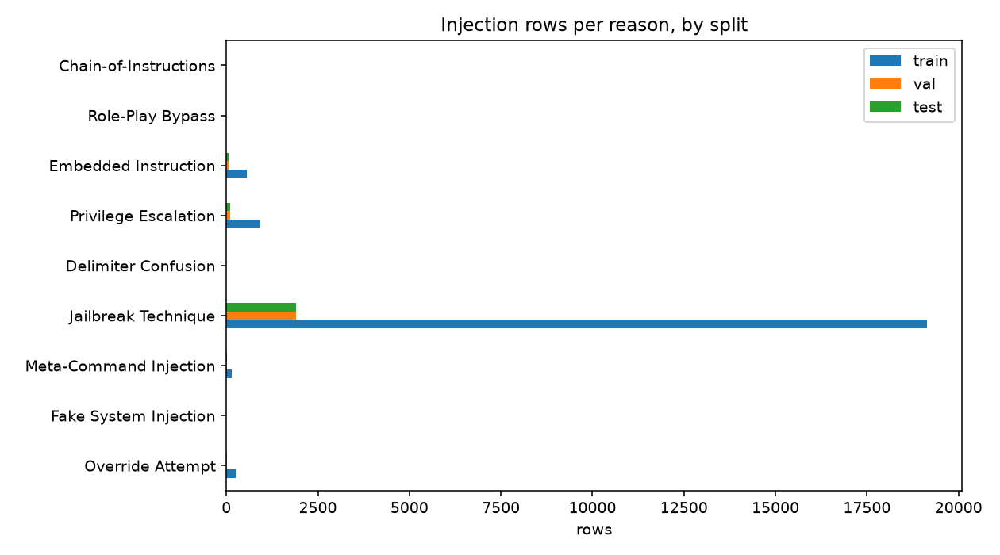

# Phase 1 Report: Dataset v3 (a4c8dd4786013cfd)

_Generated 2026-10-09 17:16 UTC_

## Build

- Dataset version: `v3`
- Config fingerprint: `a4c8dd4786013cfddd09959eb76105808ccf986687152acd19a0a998d1f17811`
- Created: 2026-10-09T17:16:40.546899+00:00
- Output: `data/source-clean-v3`
- Reasons with training rows: Embedded Instruction, Jailbreak Technique, Meta-Command Injection, Override Attempt, Privilege Escalation

## Sources

- `nvidia/Nemotron-Safety-Guard-Dataset-v3`
- `allenai/wildguardmix/wildguardtrain`
- `allenai/wildguardmix/wildguardtest`
- `deepset/prompt-injections`
- `jackhhao/jailbreak-classification`
- `geodesic-research/bipia`
- `wikimedia/wikipedia/20231101.en`
- `puyang2025/seven-phishing-email-datasets`

Excluded:

- `xTRam1/safe-guard-prompt-injection`: no license on the dataset card
- `nvidia/Nemotron-RL-Agentic-Indirect-Prompt-Injection-v1`: raw agent tool-call traces without a documented schema; deferred to a later data version

## Rows per split

|  | rows | injection | safe | augmented |
|---|---|---|---|---|
| train | 47570 | 21034 | 26536 | 4207 |
| val | 5419 | 2102 | 3317 | 0 |
| test | 5419 | 2102 | 3317 | 0 |
| adversarial_test | 2102 | 2102 | 0 | 2102 |
| lora_holdout | 2086 | 1141 | 945 | 0 |

## Rows per source and split

|  | train | val | test | adversarial_test | lora_holdout |
|---|---|---|---|---|---|
| bipia_clean | 146 | 18 | 18 | 0 | 0 |
| bipia_injected | 554 | 53 | 53 | 53 | 0 |
| deepset_benign | 318 | 40 | 40 | 0 | 0 |
| deepset_injection | 262 | 26 | 26 | 26 | 0 |
| email_ham | 2399 | 300 | 300 | 0 | 0 |
| jackhhao_benign | 510 | 64 | 64 | 0 | 0 |
| jackhhao_jailbreak | 631 | 65 | 65 | 65 | 0 |
| nemotron_jailbreaking | 8193 | 819 | 819 | 819 | 0 |
| wikipedia_paragraph | 4800 | 600 | 600 | 0 | 0 |
| wildguard_adversarial | 11394 | 1139 | 1139 | 1139 | 0 |
| wildguard_benign | 9156 | 1145 | 1144 | 0 | 0 |
| wildguard_benign_adversarial | 9207 | 1150 | 1151 | 0 | 0 |
| nemotron_test_jailbreaking | 0 | 0 | 0 | 0 | 800 |
| wildguard_test | 0 | 0 | 0 | 0 | 1286 |

## Injection rows per reason and split

|  | train | val | test | adversarial_test | lora_holdout |
|---|---|---|---|---|---|
| Override Attempt | 262 | 26 | 26 | 26 | 0 |
| Fake System Injection | 0 | 0 | 0 | 0 | 0 |
| Meta-Command Injection | 151 | 15 | 15 | 15 | 31 |
| Jailbreak Technique | 19142 | 1914 | 1914 | 1914 | 1060 |
| Delimiter Confusion | 0 | 0 | 0 | 0 | 0 |
| Privilege Escalation | 925 | 94 | 94 | 94 | 50 |
| Embedded Instruction | 554 | 53 | 53 | 53 | 0 |
| Role-Play Bypass | 0 | 0 | 0 | 0 | 0 |
| Chain-of-Instructions | 0 | 0 | 0 | 0 | 0 |

## Rows per shape and split

|  | train | val | test | adversarial_test | lora_holdout |
|---|---|---|---|---|---|
| chat | 39671 | 4448 | 4448 | 2049 | 2086 |
| document | 7899 | 971 | 971 | 53 | 0 |

## Leakage indicators

- Cross-split group and fingerprint overlap: none (asserted)
- Held-out rows removed from the pool: exact and near-duplicate match (asserted)
- 6-word template twin rate, val: 35.9%
- 6-word template twin rate, test: 34.4%
- Ten largest split groups (rows): 309, 115, 108, 107, 101, 84, 66, 43, 40, 37

## Labelling notes

- **wildguard_benign_adversarial**: adversarial but unharmful WildGuardMix rows are SAFE, matching the LoRA; kept as a separate slice
- **nemotron_jailbreaking**: every jailbreaking row is INJECTION regardless of prompt_label, matching the LoRA; prompt_label kept in attack_type
- **reason_labels**: map-derived from source or subcategory, not human annotated; report, do not gate
