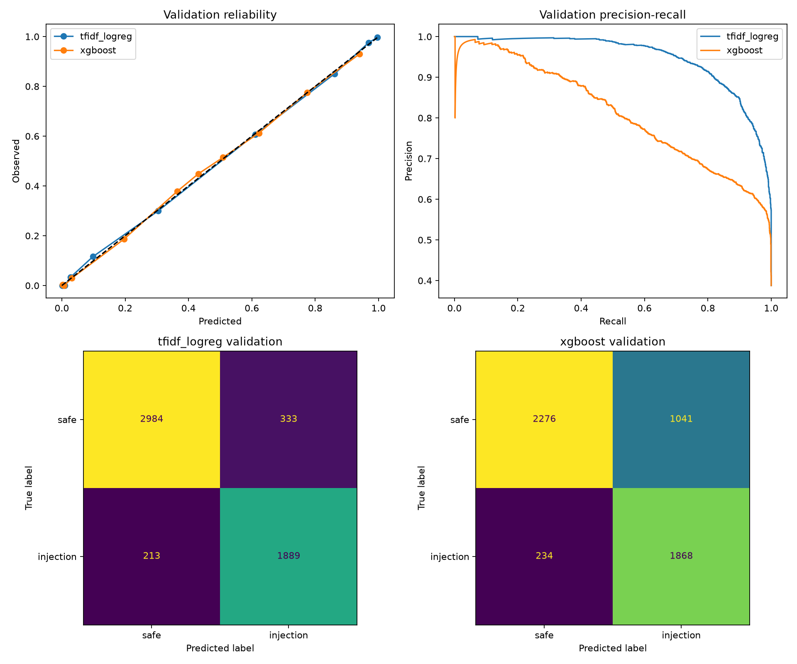
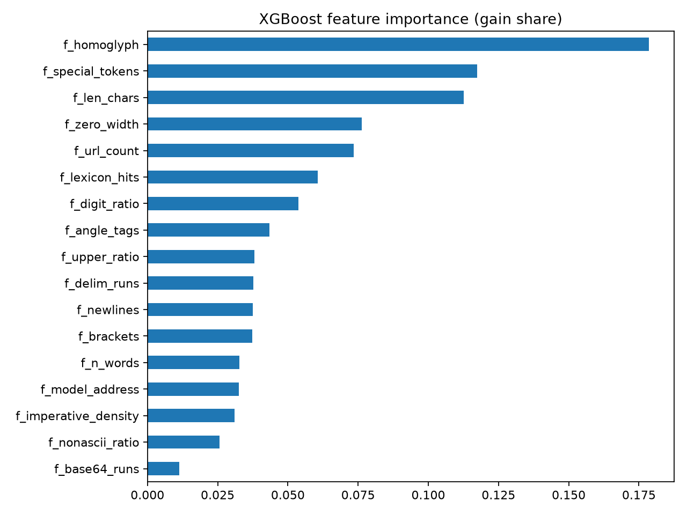

# Phase 2 Report: Baselines on dataset v3 (a4c8dd4786013cfd)

_Generated 2026-10-09 17:17 UTC_

## Run

- Run ID: `phase2-v3-a4c8dd4786013cfd`
- Dataset fingerprint: `a4c8dd4786013cfddd09959eb76105808ccf986687152acd19a0a998d1f17811`
- Chosen baseline (val F1, recall, FPR): **tfidf_logreg**
- XGBoost best iteration: 473 (early stopping fired)
- Device: cuda, torch 2.10.0a0+b558c986e8.nv25.11, xgboost 3.4.0
- Artifacts: `models/phase2-v3-a4c8dd4786013cfd`

## Validation (selection data)

|  | threshold | precision | recall | f1 | roc_auc | average_precision | brier | log_loss | false_positive_rate |
|---|---|---|---|---|---|---|---|---|---|
| tfidf_logreg | 0.4202 | 0.8501 | 0.8987 | 0.8737 | 0.9656 | 0.9488 | 0.0724 | 0.2313 | 0.1004 |
| xgboost | 0.3741 | 0.6421 | 0.8887 | 0.7456 | 0.8770 | 0.8117 | 0.1381 | 0.4092 | 0.3138 |

## Locked test

|  | threshold | precision | recall | f1 | roc_auc | average_precision | brier | log_loss | false_positive_rate |
|---|---|---|---|---|---|---|---|---|---|
| tfidf_logreg | 0.4202 | 0.8546 | 0.9006 | 0.8770 | 0.9704 | 0.9563 | 0.0667 | 0.2147 | 0.0971 |
| xgboost | 0.3741 | 0.6434 | 0.8825 | 0.7442 | 0.8824 | 0.8243 | 0.1351 | 0.4004 | 0.3099 |

95% bootstrap intervals (1,000 resamples):

|  | average_precision | roc_auc | f1 | recall | false_positive_rate |
|---|---|---|---|---|---|
| tfidf_logreg | 0.9502 to 0.9622 | 0.9667 to 0.9741 | 0.8662 to 0.8871 | 0.8874 to 0.9125 | 0.0876 to 0.1069 |
| xgboost | 0.8095 to 0.8385 | 0.8739 to 0.8907 | 0.7307 to 0.7578 | 0.8683 to 0.8953 | 0.2941 to 0.3245 |

## Recall at FPR budget (test)

|  | fpr_0.01 | fpr_0.005 | fpr_0.001 |
|---|---|---|---|
| tfidf_logreg | 0.6413 | 0.5385 | 0.4234 |
| xgboost | 0.2797 | 0.2074 | 0.1365 |

## Test slices by shape

|  | rows | recall | false_positive_rate | f1 |
|---|---|---|---|---|
| ('tfidf_logreg', 'chat') | 4448.0000 | 0.9019 | 0.1280 | 0.8792 |
| ('tfidf_logreg', 'document') | 971.0000 | 0.8491 | 0.0163 | 0.7965 |
| ('xgboost', 'chat') | 4448.0000 | 0.8878 | 0.3743 | 0.7633 |
| ('xgboost', 'document') | 971.0000 | 0.6792 | 0.1416 | 0.3288 |

## Test slices by source

|  | rows | recall | false_positive_rate | f1 |
|---|---|---|---|---|
| ('tfidf_logreg', 'bipia_clean') | 18.0000 |  | 0.5000 |  |
| ('tfidf_logreg', 'bipia_injected') | 53.0000 | 0.8491 |  |  |
| ('tfidf_logreg', 'deepset_benign') | 40.0000 |  | 0.0000 |  |
| ('tfidf_logreg', 'deepset_injection') | 26.0000 | 0.4615 |  |  |
| ('tfidf_logreg', 'email_ham') | 300.0000 |  | 0.0000 |  |
| ('tfidf_logreg', 'jackhhao_benign') | 64.0000 |  | 0.0312 |  |
| ('tfidf_logreg', 'jackhhao_jailbreak') | 65.0000 | 0.9538 |  |  |
| ('tfidf_logreg', 'nemotron_jailbreaking') | 819.0000 | 0.9634 |  |  |
| ('tfidf_logreg', 'wikipedia_paragraph') | 600.0000 |  | 0.0100 |  |
| ('tfidf_logreg', 'wildguard_adversarial') | 1139.0000 | 0.8648 |  |  |
| ('tfidf_logreg', 'wildguard_benign') | 1144.0000 |  | 0.0096 |  |
| ('tfidf_logreg', 'wildguard_benign_adversarial') | 1151.0000 |  | 0.2554 |  |
| ('xgboost', 'bipia_clean') | 18.0000 |  | 0.7222 |  |
| ('xgboost', 'bipia_injected') | 53.0000 | 0.6792 |  |  |
| ('xgboost', 'deepset_benign') | 40.0000 |  | 0.0250 |  |
| ('xgboost', 'deepset_injection') | 26.0000 | 0.5000 |  |  |
| ('xgboost', 'email_ham') | 300.0000 |  | 0.0367 |  |
| ('xgboost', 'jackhhao_benign') | 64.0000 |  | 0.3750 |  |
| ('xgboost', 'jackhhao_jailbreak') | 65.0000 | 0.9692 |  |  |
| ('xgboost', 'nemotron_jailbreaking') | 819.0000 | 0.9389 |  |  |
| ('xgboost', 'wikipedia_paragraph') | 600.0000 |  | 0.1767 |  |
| ('xgboost', 'wildguard_adversarial') | 1139.0000 | 0.8551 |  |  |
| ('xgboost', 'wildguard_benign') | 1144.0000 |  | 0.0402 |  |
| ('xgboost', 'wildguard_benign_adversarial') | 1151.0000 |  | 0.7185 |  |

## Locked adversarial test

|  | threshold | injection_recall | probability_mean | probability_median | probability_min | probability_max |
|---|---|---|---|---|---|---|
| tfidf_logreg | 0.4202 | 0.9548 | 0.9023 | 0.9836 | 0.0082 | 1.0000 |
| xgboost | 0.3741 | 0.9596 | 0.8788 | 0.9752 | 0.0056 | 1.0000 |

By variant kind:

|  | rows | recall |
|---|---|---|
| ('tfidf_logreg', 'case_noise') | 407.0000 | 0.9853 |
| ('tfidf_logreg', 'delimiter_wrap') | 413.0000 | 0.9806 |
| ('tfidf_logreg', 'homoglyph') | 411.0000 | 0.9976 |
| ('tfidf_logreg', 'whitespace_noise') | 434.0000 | 0.8894 |
| ('tfidf_logreg', 'zero_width') | 437.0000 | 0.9268 |
| ('xgboost', 'case_noise') | 407.0000 | 0.9853 |
| ('xgboost', 'delimiter_wrap') | 413.0000 | 0.9831 |
| ('xgboost', 'homoglyph') | 411.0000 | 1.0000 |
| ('xgboost', 'whitespace_noise') | 434.0000 | 0.9286 |
| ('xgboost', 'zero_width') | 437.0000 | 0.9062 |

## Plots

