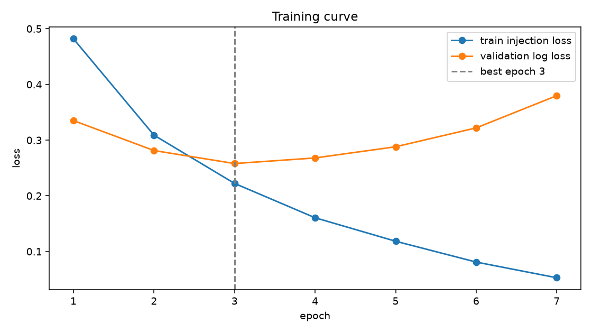

# Phase 3 Report: CNN + BiGRU on dataset v3 (a4c8dd4786013cfd)

_Generated 2026-10-09 17:23 UTC_

## Run

- Run ID: `phase3-cnn-bigru-v3-a4c8dd4786013cfd`
- Dataset fingerprint: `a4c8dd4786013cfddd09959eb76105808ccf986687152acd19a0a998d1f17811`
- Parameters: 6,681,610; weights on disk: 26.7 MB
- Config: vocab 50,000, 512 tokens, embedding 128, hidden 128, cnn 128, dropout 0.25, batch 256, lr 0.002, reason loss weight 0.5
- Best epoch 3 of 7 run (patience 4); threshold 0.5148 by validation F1
- Device: cuda, bf16 True, torch 2.10.0a0+b558c986e8.nv25.11
- Artifacts: `models/phase3-cnn-bigru-v3-a4c8dd4786013cfd`

## Training curve

|  | train_loss | train_injection_loss | train_reason_loss | validation_log_loss | validation_reason_accuracy_on_positives | seconds |
|---|---|---|---|---|---|---|
| 1 | 0.6541 | 0.4819 | 0.3445 | 0.3351 | 0.9420 | 30.4000 |
| 2 | 0.4080 | 0.3089 | 0.1984 | 0.2813 | 0.9443 | 30.1000 |
| 3 | 0.2964 | 0.2222 | 0.1484 | 0.2579 | 0.9443 | 30.1000 |
| 4 | 0.2157 | 0.1606 | 0.1102 | 0.2680 | 0.9486 | 30.1000 |
| 5 | 0.1597 | 0.1184 | 0.0826 | 0.2881 | 0.9481 | 30.2000 |
| 6 | 0.1111 | 0.0810 | 0.0601 | 0.3220 | 0.9320 | 30.3000 |
| 7 | 0.0744 | 0.0529 | 0.0432 | 0.3798 | 0.9496 | 30.2000 |

## Headline metrics

|  | threshold | precision | recall | f1 | roc_auc | average_precision | brier | log_loss | false_positive_rate |
|---|---|---|---|---|---|---|---|---|---|
| validation | 0.5148 | 0.8269 | 0.8796 | 0.8525 | 0.9594 | 0.9406 | 0.0824 | 0.2579 | 0.1167 |
| test | 0.5148 | 0.8367 | 0.8849 | 0.8601 | 0.9626 | 0.9460 | 0.0785 | 0.2497 | 0.1094 |

95% bootstrap intervals on test (1,000 resamples):

|  | average_precision | roc_auc | f1 | recall | false_positive_rate |
|---|---|---|---|---|---|
| test | 0.9393 to 0.9524 | 0.9584 to 0.9669 | 0.8493 to 0.8710 | 0.8712 to 0.8981 | 0.0985 to 0.1192 |

## Recall at FPR budget (test)

|  | recall | threshold | achieved_fpr |
|---|---|---|---|
| fpr_0.01 | 0.5771 | 0.9526 | 0.0099 |
| fpr_0.005 | 0.5038 | 0.9740 | 0.0048 |
| fpr_0.001 | 0.3278 | 0.9946 | 0.0009 |

## Test slices by shape

|  | rows | recall | false_positive_rate | f1 |
|---|---|---|---|---|
| chat | 4448.0000 | 0.8824 | 0.1463 | 0.8593 |
| document | 971.0000 | 0.9811 | 0.0131 | 0.8889 |

## Test slices by source

|  | rows | recall | false_positive_rate | f1 |
|---|---|---|---|---|
| bipia_clean | 18.0000 |  | 0.1667 |  |
| bipia_injected | 53.0000 | 0.9811 |  |  |
| deepset_benign | 40.0000 |  | 0.0250 |  |
| deepset_injection | 26.0000 | 0.6154 |  |  |
| email_ham | 300.0000 |  | 0.0000 |  |
| jackhhao_benign | 64.0000 |  | 0.0625 |  |
| jackhhao_jailbreak | 65.0000 | 0.9692 |  |  |
| nemotron_jailbreaking | 819.0000 | 0.9695 |  |  |
| wikipedia_paragraph | 600.0000 |  | 0.0150 |  |
| wildguard_adversarial | 1139.0000 | 0.8209 |  |  |
| wildguard_benign | 1144.0000 |  | 0.0184 |  |
| wildguard_benign_adversarial | 1151.0000 |  | 0.2824 |  |

## Reason head on test true positives

- Rows: 1860; accuracy 0.9596774193548387; top-2 accuracy 0.9978494623655914; macro-F1 over defined reasons 0.7387014042065028
- Reasons with training rows: Embedded Instruction, Jailbreak Technique, Meta-Command Injection, Override Attempt, Privilege Escalation

|  | support | predicted | precision | recall | status |
|---|---|---|---|---|---|
| Override Attempt | 16 | 14 | 1.0000 | 0.8750 | defined |
| Fake System Injection | 0 | 0 |  |  | undefined: no training rows |
| Meta-Command Injection | 7 | 4 | 0.5000 | 0.2857 | defined |
| Jailbreak Technique | 1704 | 1755 | 0.9647 | 0.9935 | defined |
| Delimiter Confusion | 0 | 0 |  |  | undefined: no training rows |
| Privilege Escalation | 81 | 36 | 0.6944 | 0.3086 | defined |
| Embedded Instruction | 52 | 51 | 1.0000 | 0.9808 | defined |
| Role-Play Bypass | 0 | 0 |  |  | undefined: no training rows |
| Chain-of-Instructions | 0 | 0 |  |  | undefined: no training rows |

## Locked adversarial test

|  | threshold | injection_recall | probability_mean | probability_median | probability_min | probability_max |
|---|---|---|---|---|---|---|
| adversarial_test | 0.5148 | 0.9581 | 0.9398 | 0.9971 | 0.0005 | 1.0000 |

By variant kind:

|  | rows | recall |
|---|---|---|
| case_noise | 407.0000 | 0.9902 |
| delimiter_wrap | 413.0000 | 0.9976 |
| homoglyph | 411.0000 | 1.0000 |
| whitespace_noise | 434.0000 | 0.8825 |
| zero_width | 437.0000 | 0.9268 |

## CPU latency

CPU: aarch64, 10 torch threads. Target: p95 under 100 ms for the batch of ten; met: yes.

|  | batch_size | tokens | p50_ms | p95_ms | chunks_per_second |
|---|---|---|---|---|---|
| batch_10_x_512 | 10.00 | 512.00 | 28.90 | 34.87 |  |
| batch_1_x_512 | 1.00 | 512.00 | 12.34 | 14.07 |  |
| batch_32_x_512 | 32.00 | 512.00 | 106.87 | 123.16 | 299.44 |
