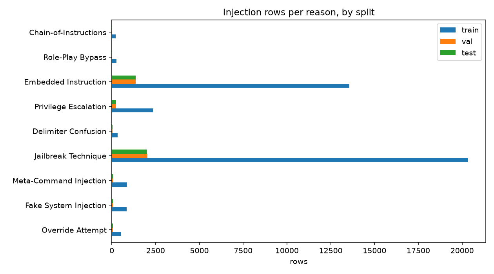

# Phase 1 Report: Dataset v4 (7f42d9d83806880d)

_Generated 2026-10-09 22:09 UTC_

## Build

- Dataset version: `v4`
- Config fingerprint: `7f42d9d83806880d95a44645173227c6008b5291538e8af40eaae0ed37cf0486`
- Created: 2026-10-09T22:09:58.333640+00:00
- Output: `data/source-clean-v4`
- Reasons with training rows: Chain-of-Instructions, Delimiter Confusion, Embedded Instruction, Fake System Injection, Jailbreak Technique, Meta-Command Injection, Override Attempt, Privilege Escalation, Role-Play Bypass

## Sources

- `nvidia/Nemotron-Safety-Guard-Dataset-v3`
- `allenai/wildguardmix/wildguardtrain`
- `allenai/wildguardmix/wildguardtest`
- `deepset/prompt-injections`
- `jackhhao/jailbreak-classification`
- `geodesic-research/bipia`
- `wikimedia/wikipedia/20231101.en`
- `puyang2025/seven-phishing-email-datasets`
- `microsoft/llmail-inject-challenge`
- `sleeepeer/PIArena`
- `nvidia/Nemotron-RL-Agentic-Indirect-Prompt-Injection-v1`
- `rgeada/k8s-resource-prompt-injection`
- `3nesdeniz/agentic-prompt-injection-5k`
- `3nesdeniz/agentic-prompt-injection-boundary-pairs`
- `3nesdeniz/english-prompt-injection-3k`
- `TrustAIRLab/in-the-wild-jailbreak-prompts/jailbreak_2023_12_25`
- `TrustAIRLab/in-the-wild-jailbreak-prompts/regular_2023_12_25`
- `axiotic/ogma-prompt-injection-benign`
- `S-Labs/prompt-injection-dataset`
- `leolee99/NotInject`

Excluded:

- `xTRam1/safe-guard-prompt-injection`: no license on the dataset card
- `rogue-security/prompt-injections-benchmark`: CC-BY-NC-4.0, non-commercial
- `Mindgard/evaded-prompt-injection-and-jailbreak-samples`: CC-BY-NC-4.0, non-commercial
- `hackaprompt/hackaprompt-dataset`: gated
- `Necent/llm-jailbreak-prompt-injection-dataset`: gated
- `prodnull/prompt-injection-repo-dataset`: gated
- `jayavibhav/prompt-injection-safety`: no license
- `guychuk/open-prompt-injection`: no license
- `xxz224/prompt-injection-attack-dataset`: no license
- `hirundo-io/prompt-injection-purple-llama`: no license, empty card
- `Smooth-3/llm-prompt-injection-attacks`: labels are rule-derived from other sets; noisy
- `Horizon-Labs/prompt-injection-eval-suite`: evaluation suite, not a training source; contains the 3nesdeniz test splits
- `S-Labs/prompt-injection-dataset (positives)`: no attack category, so no reason label; benign rows are used

## Rows per split

|  | rows | injection | safe | augmented |
|---|---|---|---|---|
| train | 82800 | 39315 | 43485 | 7863 |
| val | 9367 | 3931 | 5436 | 0 |
| test | 9456 | 3904 | 5552 | 0 |
| adversarial_test | 3904 | 3904 | 0 | 3904 |
| lora_holdout | 2086 | 1141 | 945 | 0 |

## Rows per source and split

|  | train | val | test | adversarial_test | lora_holdout |
|---|---|---|---|---|---|
| agentic5k_benign | 1752 | 219 | 214 | 0 | 0 |
| agentic5k_injection | 2762 | 275 | 277 | 277 | 0 |
| bipia_clean | 146 | 18 | 18 | 0 | 0 |
| bipia_injected | 545 | 53 | 53 | 53 | 0 |
| boundary_benign | 480 | 60 | 60 | 0 | 0 |
| boundary_injection | 601 | 60 | 60 | 60 | 0 |
| deepset_benign | 320 | 40 | 38 | 0 | 0 |
| deepset_injection | 263 | 26 | 26 | 26 | 0 |
| email_ham | 2404 | 301 | 294 | 0 | 0 |
| english3k_benign | 148 | 19 | 18 | 0 | 0 |
| english3k_injection | 1930 | 193 | 189 | 189 | 0 |
| itw_jailbreak | 680 | 70 | 69 | 69 | 0 |
| itw_regular_benign | 3904 | 488 | 464 | 0 | 0 |
| jackhhao_benign | 513 | 64 | 61 | 0 | 0 |
| jackhhao_jailbreak | 648 | 65 | 64 | 64 | 0 |
| k8s_clean | 1594 | 199 | 194 | 0 | 0 |
| k8s_injected | 2509 | 250 | 252 | 252 | 0 |
| llmail_clean | 128 | 16 | 16 | 0 | 0 |
| llmail_injected | 7834 | 787 | 797 | 797 | 0 |
| nemotron_ipi_clean | 282 | 35 | 34 | 0 | 0 |
| nemotron_ipi_injected | 234 | 23 | 23 | 23 | 0 |
| nemotron_jailbreaking | 8192 | 821 | 808 | 808 | 0 |
| ogma_benign | 4808 | 601 | 571 | 0 | 0 |
| piarena_clean | 1335 | 167 | 163 | 0 | 0 |
| piarena_injected | 1659 | 167 | 163 | 163 | 0 |
| slabs_benign | 2408 | 301 | 286 | 0 | 0 |
| wikipedia_paragraph | 4810 | 602 | 588 | 0 | 0 |
| wildguard_adversarial | 11458 | 1141 | 1123 | 1123 | 0 |
| wildguard_benign | 9201 | 1150 | 1094 | 0 | 0 |
| wildguard_benign_adversarial | 9252 | 1156 | 1100 | 0 | 0 |
| notinject_benign | 0 | 0 | 339 | 0 | 0 |
| nemotron_test_jailbreaking | 0 | 0 | 0 | 0 | 800 |
| wildguard_test | 0 | 0 | 0 | 0 | 1286 |

## Injection rows per reason and split

|  | train | val | test | adversarial_test | lora_holdout |
|---|---|---|---|---|---|
| Override Attempt | 532 | 53 | 52 | 52 | 0 |
| Fake System Injection | 839 | 82 | 82 | 82 | 0 |
| Meta-Command Injection | 874 | 87 | 86 | 86 | 31 |
| Jailbreak Technique | 20333 | 2032 | 2019 | 2019 | 1060 |
| Delimiter Confusion | 329 | 33 | 32 | 32 | 0 |
| Privilege Escalation | 2361 | 236 | 234 | 234 | 50 |
| Embedded Instruction | 13571 | 1361 | 1352 | 1352 | 0 |
| Role-Play Bypass | 264 | 26 | 26 | 26 | 0 |
| Chain-of-Instructions | 212 | 21 | 21 | 21 | 0 |

## Rows per shape and split

|  | train | val | test | adversarial_test | lora_holdout |
|---|---|---|---|---|---|
| agentic | 4884 | 534 | 531 | 297 | 0 |
| chat | 54269 | 6197 | 6310 | 2309 | 2086 |
| document | 23647 | 2636 | 2615 | 1298 | 0 |

## Leakage indicators

- Cross-split group and fingerprint overlap: none (asserted)
- Held-out rows removed from the pool: exact and near-duplicate match (asserted)
- 6-word template twin rate, val (chat positives): 34.5%
- 6-word template twin rate, test (chat positives): 32.4%
- 6-word template twin rate, val/agentic: 16.6%
- 6-word template twin rate, val/chat: 34.5%
- 6-word template twin rate, val/document: 64.6%
- 6-word template twin rate, test/agentic: 18.5%
- 6-word template twin rate, test/chat: 32.4%
- 6-word template twin rate, test/document: 59.4%
- 6-word template twin rate of test positives by source: k8s_injected 94%, llmail_injected 64%, boundary_injection 43%, nemotron_ipi_injected 39%, nemotron_jailbreaking 38%, wildguard_adversarial 32%, jackhhao_jailbreak 30%, agentic5k_injection 18%, english3k_injection 16%, itw_jailbreak 14%, deepset_injection 12%, bipia_injected 8%, piarena_injected 2%
- Ten largest split groups (rows): 309, 200, 115, 113, 108, 107, 103, 101, 84, 75

## Labelling notes

- **wildguard_benign_adversarial**: adversarial but unharmful WildGuardMix rows are SAFE, matching the LoRA; kept as a separate slice
- **nemotron_jailbreaking**: every jailbreaking row is INJECTION regardless of prompt_label, matching the LoRA; prompt_label kept in attack_type
- **reason_labels**: map-derived from source or subcategory, not human annotated; report, do not gate
