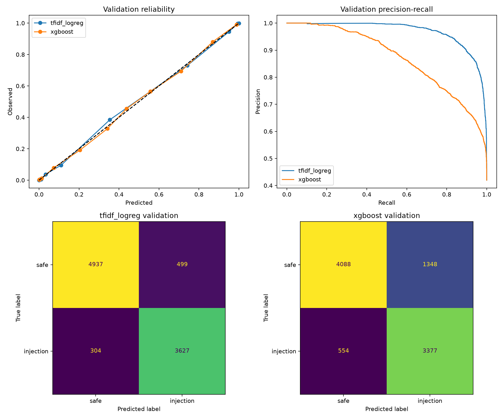
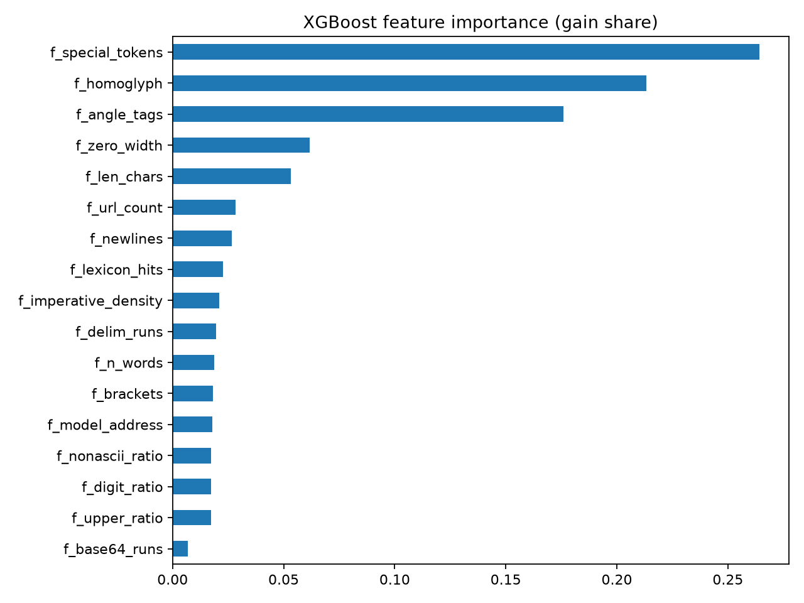

# Phase 2 Report: Baselines on dataset v4 (7f42d9d83806880d)

_Generated 2026-10-09 22:20 UTC_

## Run

- Run ID: `phase2-v4-7f42d9d83806880d`
- Dataset fingerprint: `7f42d9d83806880d95a44645173227c6008b5291538e8af40eaae0ed37cf0486`
- Chosen baseline (val F1, recall, FPR): **tfidf_logreg**
- XGBoost best iteration: 1300 (early stopping fired)
- Device: cuda, torch 2.10.0a0+b558c986e8.nv25.11, xgboost 3.4.0
- Artifacts: `models/phase2-v4-7f42d9d83806880d`

## Validation (selection data)

|  | threshold | precision | recall | f1 | roc_auc | average_precision | brier | log_loss | false_positive_rate |
|---|---|---|---|---|---|---|---|---|---|
| tfidf_logreg | 0.3840 | 0.8791 | 0.9227 | 0.9003 | 0.9757 | 0.9692 | 0.0599 | 0.1964 | 0.0918 |
| xgboost | 0.3872 | 0.7147 | 0.8591 | 0.7803 | 0.8983 | 0.8709 | 0.1280 | 0.3874 | 0.2480 |

## Locked test

|  | threshold | precision | recall | f1 | roc_auc | average_precision | brier | log_loss | false_positive_rate |
|---|---|---|---|---|---|---|---|---|---|
| tfidf_logreg | 0.3840 | 0.8732 | 0.9278 | 0.8997 | 0.9751 | 0.9676 | 0.0600 | 0.1986 | 0.0947 |
| xgboost | 0.3872 | 0.7048 | 0.8537 | 0.7722 | 0.8981 | 0.8672 | 0.1278 | 0.3848 | 0.2514 |

95% bootstrap intervals (1,000 resamples):

|  | average_precision | roc_auc | f1 | recall | false_positive_rate |
|---|---|---|---|---|---|
| tfidf_logreg | 0.9639 to 0.9709 | 0.9727 to 0.9776 | 0.8932 to 0.9062 | 0.9205 to 0.9357 | 0.0874 to 0.1020 |
| xgboost | 0.8584 to 0.8756 | 0.8917 to 0.9039 | 0.7620 to 0.7816 | 0.8425 to 0.8638 | 0.2398 to 0.2631 |

## Recall at FPR budget (test)

|  | fpr_0.01 | fpr_0.005 | fpr_0.001 |
|---|---|---|---|
| tfidf_logreg | 0.7024 | 0.6301 | 0.3783 |
| xgboost | 0.3601 | 0.2946 | 0.2016 |

## Test slices by shape

|  | rows | recall | false_positive_rate | f1 |
|---|---|---|---|---|
| ('tfidf_logreg', 'agentic') | 531.0000 | 0.9630 | 0.0256 | 0.9711 |
| ('tfidf_logreg', 'chat') | 6310.0000 | 0.8995 | 0.1137 | 0.8581 |
| ('tfidf_logreg', 'document') | 2615.0000 | 0.9700 | 0.0494 | 0.9603 |
| ('xgboost', 'agentic') | 531.0000 | 0.8855 | 0.4188 | 0.7994 |
| ('xgboost', 'chat') | 6310.0000 | 0.8068 | 0.2664 | 0.7113 |
| ('xgboost', 'document') | 2615.0000 | 0.9299 | 0.1762 | 0.8820 |

## Test slices by source

|  | rows | recall | false_positive_rate | f1 |
|---|---|---|---|---|
| ('tfidf_logreg', 'agentic5k_benign') | 214.0000 |  | 0.0234 |  |
| ('tfidf_logreg', 'agentic5k_injection') | 277.0000 | 0.9603 |  |  |
| ('tfidf_logreg', 'bipia_clean') | 18.0000 |  | 0.8333 |  |
| ('tfidf_logreg', 'bipia_injected') | 53.0000 | 0.9811 |  |  |
| ('tfidf_logreg', 'boundary_benign') | 60.0000 |  | 0.0167 |  |
| ('tfidf_logreg', 'boundary_injection') | 60.0000 | 1.0000 |  |  |
| ('tfidf_logreg', 'deepset_benign') | 38.0000 |  | 0.0000 |  |
| ('tfidf_logreg', 'deepset_injection') | 26.0000 | 0.5769 |  |  |
| ('tfidf_logreg', 'email_ham') | 294.0000 |  | 0.0136 |  |
| ('tfidf_logreg', 'english3k_benign') | 18.0000 |  | 0.0556 |  |
| ('tfidf_logreg', 'english3k_injection') | 189.0000 | 0.9471 |  |  |
| ('tfidf_logreg', 'itw_jailbreak') | 69.0000 | 0.6957 |  |  |
| ('tfidf_logreg', 'itw_regular_benign') | 464.0000 |  | 0.0884 |  |
| ('tfidf_logreg', 'jackhhao_benign') | 61.0000 |  | 0.0656 |  |
| ('tfidf_logreg', 'jackhhao_jailbreak') | 64.0000 | 0.8594 |  |  |
| ('tfidf_logreg', 'k8s_clean') | 194.0000 |  | 0.1598 |  |
| ('tfidf_logreg', 'k8s_injected') | 252.0000 | 0.9444 |  |  |
| ('tfidf_logreg', 'llmail_clean') | 16.0000 |  | 0.0000 |  |
| ('tfidf_logreg', 'llmail_injected') | 797.0000 | 1.0000 |  |  |
| ('tfidf_logreg', 'nemotron_ipi_clean') | 34.0000 |  | 0.0000 |  |
| ('tfidf_logreg', 'nemotron_ipi_injected') | 23.0000 | 1.0000 |  |  |
| ('tfidf_logreg', 'nemotron_jailbreaking') | 808.0000 | 0.9319 |  |  |
| ('tfidf_logreg', 'notinject_benign') | 339.0000 |  | 0.1121 |  |
| ('tfidf_logreg', 'ogma_benign') | 571.0000 |  | 0.0070 |  |
| ('tfidf_logreg', 'piarena_clean') | 163.0000 |  | 0.0552 |  |
| ('tfidf_logreg', 'piarena_injected') | 163.0000 | 0.8528 |  |  |
| ('tfidf_logreg', 'slabs_benign') | 286.0000 |  | 0.0035 |  |
| ('tfidf_logreg', 'wikipedia_paragraph') | 588.0000 |  | 0.0102 |  |
| ('tfidf_logreg', 'wildguard_adversarial') | 1123.0000 | 0.8878 |  |  |
| ('tfidf_logreg', 'wildguard_benign') | 1094.0000 |  | 0.0101 |  |
| ('tfidf_logreg', 'wildguard_benign_adversarial') | 1100.0000 |  | 0.3227 |  |
| ('xgboost', 'agentic5k_benign') | 214.0000 |  | 0.3925 |  |
| ('xgboost', 'agentic5k_injection') | 277.0000 | 0.8917 |  |  |
| ('xgboost', 'bipia_clean') | 18.0000 |  | 0.6111 |  |
| ('xgboost', 'bipia_injected') | 53.0000 | 0.7358 |  |  |
| ('xgboost', 'boundary_benign') | 60.0000 |  | 0.7667 |  |
| ('xgboost', 'boundary_injection') | 60.0000 | 0.9000 |  |  |
| ('xgboost', 'deepset_benign') | 38.0000 |  | 0.1579 |  |
| ('xgboost', 'deepset_injection') | 26.0000 | 0.5000 |  |  |
| ('xgboost', 'email_ham') | 294.0000 |  | 0.0510 |  |
| ('xgboost', 'english3k_benign') | 18.0000 |  | 0.1111 |  |
| ('xgboost', 'english3k_injection') | 189.0000 | 0.7407 |  |  |
| ('xgboost', 'itw_jailbreak') | 69.0000 | 0.5797 |  |  |
| ('xgboost', 'itw_regular_benign') | 464.0000 |  | 0.2974 |  |
| ('xgboost', 'jackhhao_benign') | 61.0000 |  | 0.4426 |  |
| ('xgboost', 'jackhhao_jailbreak') | 64.0000 | 0.7031 |  |  |
| ('xgboost', 'k8s_clean') | 194.0000 |  | 0.2835 |  |
| ('xgboost', 'k8s_injected') | 252.0000 | 0.9048 |  |  |
| ('xgboost', 'llmail_clean') | 16.0000 |  | 0.0000 |  |
| ('xgboost', 'llmail_injected') | 797.0000 | 0.9749 |  |  |
| ('xgboost', 'nemotron_ipi_clean') | 34.0000 |  | 0.1176 |  |
| ('xgboost', 'nemotron_ipi_injected') | 23.0000 | 1.0000 |  |  |
| ('xgboost', 'nemotron_jailbreaking') | 808.0000 | 0.8787 |  |  |
| ('xgboost', 'notinject_benign') | 339.0000 |  | 0.2301 |  |
| ('xgboost', 'ogma_benign') | 571.0000 |  | 0.1349 |  |
| ('xgboost', 'piarena_clean') | 163.0000 |  | 0.1350 |  |
| ('xgboost', 'piarena_injected') | 163.0000 | 0.7975 |  |  |
| ('xgboost', 'slabs_benign') | 286.0000 |  | 0.0315 |  |
| ('xgboost', 'wikipedia_paragraph') | 588.0000 |  | 0.1973 |  |
| ('xgboost', 'wildguard_adversarial') | 1123.0000 | 0.7898 |  |  |
| ('xgboost', 'wildguard_benign') | 1094.0000 |  | 0.0302 |  |
| ('xgboost', 'wildguard_benign_adversarial') | 1100.0000 |  | 0.6118 |  |

## Locked adversarial test

|  | threshold | injection_recall | probability_mean | probability_median | probability_min | probability_max |
|---|---|---|---|---|---|---|
| tfidf_logreg | 0.3840 | 0.9664 | 0.9234 | 0.9944 | 0.0055 | 1.0000 |
| xgboost | 0.3872 | 0.9544 | 0.8881 | 0.9856 | 0.0036 | 1.0000 |

By variant kind:

|  | rows | recall |
|---|---|---|
| ('tfidf_logreg', 'case_noise') | 769.0000 | 0.9766 |
| ('tfidf_logreg', 'delimiter_wrap') | 781.0000 | 0.9859 |
| ('tfidf_logreg', 'homoglyph') | 759.0000 | 0.9921 |
| ('tfidf_logreg', 'whitespace_noise') | 781.0000 | 0.9245 |
| ('tfidf_logreg', 'zero_width') | 814.0000 | 0.9545 |
| ('xgboost', 'case_noise') | 769.0000 | 0.9688 |
| ('xgboost', 'delimiter_wrap') | 781.0000 | 0.9898 |
| ('xgboost', 'homoglyph') | 759.0000 | 0.9974 |
| ('xgboost', 'whitespace_noise') | 781.0000 | 0.9193 |
| ('xgboost', 'zero_width') | 814.0000 | 0.9005 |

## Plots

