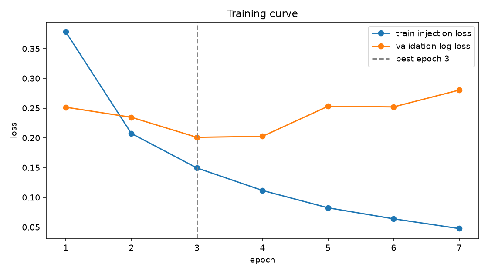

# Phase 3 Report: CNN + BiGRU on dataset v4 (7f42d9d83806880d)

_Generated 2026-10-09 22:28 UTC_

## Run

- Run ID: `phase3-cnn-bigru-v4-7f42d9d83806880d`
- Dataset fingerprint: `7f42d9d83806880d95a44645173227c6008b5291538e8af40eaae0ed37cf0486`
- Parameters: 6,681,610; weights on disk: 26.7 MB
- Config: vocab 50,000, 512 tokens, embedding 128, hidden 128, cnn 128, dropout 0.25, batch 256, lr 0.002, reason loss weight 0.5
- Best epoch 3 of 7 run (patience 4); threshold 0.4092 by validation F1
- Device: cuda, bf16 True, torch 2.10.0a0+b558c986e8.nv25.11
- Artifacts: `models/phase3-cnn-bigru-v4-7f42d9d83806880d`

## Training curve

|  | train_loss | train_injection_loss | train_reason_loss | validation_log_loss | validation_reason_accuracy_on_positives | seconds |
|---|---|---|---|---|---|---|
| 1 | 0.5905 | 0.3780 | 0.4250 | 0.2515 | 0.9122 | 52.8000 |
| 2 | 0.2945 | 0.2074 | 0.1743 | 0.2346 | 0.9313 | 51.9000 |
| 3 | 0.2036 | 0.1494 | 0.1083 | 0.2009 | 0.9364 | 52.0000 |
| 4 | 0.1496 | 0.1116 | 0.0760 | 0.2026 | 0.9420 | 52.0000 |
| 5 | 0.1109 | 0.0824 | 0.0570 | 0.2531 | 0.9415 | 52.1000 |
| 6 | 0.0854 | 0.0639 | 0.0430 | 0.2520 | 0.9407 | 51.6000 |
| 7 | 0.0637 | 0.0476 | 0.0323 | 0.2803 | 0.9407 | 51.3000 |

## Headline metrics

|  | threshold | precision | recall | f1 | roc_auc | average_precision | brier | log_loss | false_positive_rate |
|---|---|---|---|---|---|---|---|---|---|
| validation | 0.4092 | 0.8787 | 0.9155 | 0.8967 | 0.9751 | 0.9688 | 0.0621 | 0.2009 | 0.0914 |
| test | 0.4092 | 0.8726 | 0.9175 | 0.8945 | 0.9749 | 0.9669 | 0.0617 | 0.2033 | 0.0942 |

95% bootstrap intervals on test (1,000 resamples):

|  | average_precision | roc_auc | f1 | recall | false_positive_rate |
|---|---|---|---|---|---|
| test | 0.9636 to 0.9705 | 0.9724 to 0.9774 | 0.8875 to 0.9017 | 0.9089 to 0.9255 | 0.0863 to 0.1020 |

## Recall at FPR budget (test)

|  | recall | threshold | achieved_fpr |
|---|---|---|---|
| fpr_0.01 | 0.6936 | 0.9241 | 0.0099 |
| fpr_0.005 | 0.5835 | 0.9736 | 0.0047 |
| fpr_0.001 | 0.4547 | 0.9948 | 0.0005 |

## Test slices by shape

|  | rows | recall | false_positive_rate | f1 |
|---|---|---|---|---|
| agentic | 531.0000 | 0.9394 | 0.0128 | 0.9637 |
| chat | 6310.0000 | 0.8913 | 0.1225 | 0.8474 |
| document | 2615.0000 | 0.9592 | 0.0228 | 0.9677 |

## Test slices by source

|  | rows | recall | false_positive_rate | f1 |
|---|---|---|---|---|
| agentic5k_benign | 214.0000 |  | 0.0047 |  |
| agentic5k_injection | 277.0000 | 0.9350 |  |  |
| bipia_clean | 18.0000 |  | 0.1667 |  |
| bipia_injected | 53.0000 | 0.7547 |  |  |
| boundary_benign | 60.0000 |  | 0.0667 |  |
| boundary_injection | 60.0000 | 1.0000 |  |  |
| deepset_benign | 38.0000 |  | 0.0789 |  |
| deepset_injection | 26.0000 | 0.6538 |  |  |
| email_ham | 294.0000 |  | 0.0034 |  |
| english3k_benign | 18.0000 |  | 0.1111 |  |
| english3k_injection | 189.0000 | 0.9630 |  |  |
| itw_jailbreak | 69.0000 | 0.7101 |  |  |
| itw_regular_benign | 464.0000 |  | 0.0841 |  |
| jackhhao_benign | 61.0000 |  | 0.0328 |  |
| jackhhao_jailbreak | 64.0000 | 0.7812 |  |  |
| k8s_clean | 194.0000 |  | 0.0515 |  |
| k8s_injected | 252.0000 | 0.9524 |  |  |
| llmail_clean | 16.0000 |  | 0.0000 |  |
| llmail_injected | 797.0000 | 0.9925 |  |  |
| nemotron_ipi_clean | 34.0000 |  | 0.0000 |  |
| nemotron_ipi_injected | 23.0000 | 1.0000 |  |  |
| nemotron_jailbreaking | 808.0000 | 0.9493 |  |  |
| notinject_benign | 339.0000 |  | 0.1416 |  |
| ogma_benign | 571.0000 |  | 0.0105 |  |
| piarena_clean | 163.0000 |  | 0.0061 |  |
| piarena_injected | 163.0000 | 0.8650 |  |  |
| slabs_benign | 286.0000 |  | 0.0140 |  |
| wikipedia_paragraph | 588.0000 |  | 0.0255 |  |
| wildguard_adversarial | 1123.0000 | 0.8575 |  |  |
| wildguard_benign | 1094.0000 |  | 0.0110 |  |
| wildguard_benign_adversarial | 1100.0000 |  | 0.3382 |  |

## Reason head on test true positives

- Rows: 3582; accuracy 0.9558905639307649; top-2 accuracy 0.9877163595756561; macro-F1 over defined reasons 0.876274823133133
- Reasons with training rows: Chain-of-Instructions, Delimiter Confusion, Embedded Instruction, Fake System Injection, Jailbreak Technique, Meta-Command Injection, Override Attempt, Privilege Escalation, Role-Play Bypass

|  | support | predicted | precision | recall | status |
|---|---|---|---|---|---|
| Override Attempt | 43 | 54 | 0.6667 | 0.8372 | defined |
| Fake System Injection | 82 | 80 | 0.9750 | 0.9512 | defined |
| Meta-Command Injection | 77 | 68 | 1.0000 | 0.8831 | defined |
| Jailbreak Technique | 1798 | 1885 | 0.9507 | 0.9967 | defined |
| Delimiter Confusion | 32 | 32 | 0.9688 | 0.9688 | defined |
| Privilege Escalation | 213 | 164 | 0.8049 | 0.6197 | defined |
| Embedded Instruction | 1297 | 1266 | 0.9929 | 0.9692 | defined |
| Role-Play Bypass | 26 | 21 | 0.9524 | 0.7692 | defined |
| Chain-of-Instructions | 14 | 12 | 0.8333 | 0.7143 | defined |

## Locked adversarial test

|  | threshold | injection_recall | probability_mean | probability_median | probability_min | probability_max |
|---|---|---|---|---|---|---|
| adversarial_test | 0.4092 | 0.9652 | 0.9390 | 0.9980 | 0.0003 | 1.0000 |

By variant kind:

|  | rows | recall |
|---|---|---|
| case_noise | 769.0000 | 0.9688 |
| delimiter_wrap | 781.0000 | 0.9923 |
| homoglyph | 759.0000 | 0.9974 |
| whitespace_noise | 781.0000 | 0.9283 |
| zero_width | 814.0000 | 0.9410 |

## CPU latency

CPU: aarch64, 10 torch threads. Target: p95 under 100 ms for the batch of ten; met: yes.

|  | batch_size | tokens | p50_ms | p95_ms | chunks_per_second |
|---|---|---|---|---|---|
| batch_10_x_512 | 10.00 | 512.00 | 29.05 | 32.08 |  |
| batch_1_x_512 | 1.00 | 512.00 | 12.44 | 14.40 |  |
| batch_32_x_512 | 32.00 | 512.00 | 104.29 | 119.46 | 306.84 |
