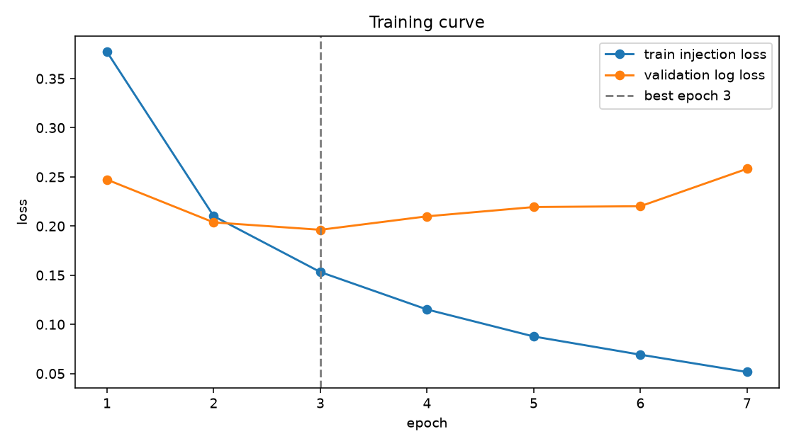

# Phase 3 Report: CNN + BiGRU on dataset v4 (7f42d9d83806880d)

_Generated 2026-10-10 12:55 UTC_

## Run

- Run ID: `phase3-cnn-bigru-v4-7f42d9d83806880d`
- Dataset fingerprint: `7f42d9d83806880d95a44645173227c6008b5291538e8af40eaae0ed37cf0486`
- Parameters: 6,681,610; weights on disk: 26.7 MB
- Config: vocab 50,000, 512 tokens, embedding 128, hidden 128, cnn 128, dropout 0.25, batch 256, lr 0.002, reason loss weight 0.5
- Best epoch 3 of 7 run (patience 4); threshold 0.3242 by validation F1
- Device: cuda, bf16 True, torch 2.10.0a0+b558c986e8.nv25.11
- Artifacts: `models/phase3-cnn-bigru-v4-7f42d9d83806880d`

## Training curve

|  | train_loss | train_injection_loss | train_reason_loss | validation_log_loss | validation_reason_accuracy_on_positives | seconds |
|---|---|---|---|---|---|---|
| 1 | 0.5899 | 0.3770 | 0.4257 | 0.2472 | 0.9140 | 118.0000 |
| 2 | 0.2978 | 0.2101 | 0.1754 | 0.2037 | 0.9364 | 117.2000 |
| 3 | 0.2081 | 0.1532 | 0.1098 | 0.1962 | 0.9359 | 117.6000 |
| 4 | 0.1544 | 0.1152 | 0.0785 | 0.2099 | 0.9425 | 117.8000 |
| 5 | 0.1164 | 0.0877 | 0.0574 | 0.2194 | 0.9407 | 117.8000 |
| 6 | 0.0908 | 0.0692 | 0.0432 | 0.2202 | 0.9504 | 118.0000 |
| 7 | 0.0691 | 0.0515 | 0.0350 | 0.2583 | 0.9420 | 117.8000 |

## Headline metrics

|  | threshold | precision | recall | f1 | roc_auc | average_precision | brier | log_loss | false_positive_rate |
|---|---|---|---|---|---|---|---|---|---|
| validation | 0.3242 | 0.8782 | 0.9285 | 0.9027 | 0.9764 | 0.9705 | 0.0605 | 0.1962 | 0.0931 |
| test | 0.3242 | 0.8676 | 0.9265 | 0.8961 | 0.9761 | 0.9690 | 0.0600 | 0.1968 | 0.0994 |

95% bootstrap intervals on test (1,000 resamples):

|  | average_precision | roc_auc | f1 | recall | false_positive_rate |
|---|---|---|---|---|---|
| test | 0.9657 to 0.9722 | 0.9738 to 0.9784 | 0.8888 to 0.9032 | 0.9181 to 0.9341 | 0.0912 to 0.1073 |

## Recall at FPR budget (test)

|  | recall | threshold | achieved_fpr |
|---|---|---|---|
| fpr_0.01 | 0.7036 | 0.8963 | 0.0097 |
| fpr_0.005 | 0.6483 | 0.9372 | 0.0047 |
| fpr_0.001 | 0.4652 | 0.9914 | 0.0009 |

## Test slices by shape

|  | rows | recall | false_positive_rate | f1 |
|---|---|---|---|---|
| agentic | 531.0000 | 0.9461 | 0.0000 | 0.9723 |
| chat | 6310.0000 | 0.8987 | 0.1300 | 0.8462 |
| document | 2615.0000 | 0.9715 | 0.0243 | 0.9734 |

## Gate verdict

- Judged on test rows of shape document, agentic (`gate_rows`), baseline `tfidf_logreg`, budgets fpr_0.01, fpr_0.005, fpr_0.001.
- A candidate clears the gate when its gate-row recall at every budget is at least the baseline's and its adversarial recall is within one point of the baseline's.
- **cnn_bigru**: fpr_0.01 0.954 vs 0.908 (ok), fpr_0.005 0.930 vs 0.867 (ok), fpr_0.001 0.890 vs 0.843 (ok); adversarial ok; **CLEARS**
- **ensemble_mean**: fpr_0.01 0.961 vs 0.908 (ok), fpr_0.005 0.943 vs 0.867 (ok), fpr_0.001 0.908 vs 0.843 (ok); adversarial ok; **CLEARS**
- **Recommended backend: `ensemble_mean`**

## Candidates on the locked test (F1-max threshold from val)

|  | threshold | precision | recall | f1 | roc_auc | average_precision | false_positive_rate |
|---|---|---|---|---|---|---|---|
| cnn_bigru | 0.3242 | 0.8676 | 0.9265 | 0.8961 | 0.9761 | 0.9690 | 0.0994 |
| tfidf_logreg | 0.3840 | 0.8732 | 0.9278 | 0.8997 | 0.9751 | 0.9676 | 0.0947 |
| ensemble_mean | 0.4350 | 0.8999 | 0.9257 | 0.9126 | 0.9811 | 0.9752 | 0.0724 |

Recall at FPR budget, all test rows:

|  | fpr_0.01 | fpr_0.005 | fpr_0.001 |
|---|---|---|---|
| cnn_bigru | 0.7036 | 0.6483 | 0.4652 |
| tfidf_logreg | 0.7024 | 0.6301 | 0.3783 |
| ensemble_mean | 0.7503 | 0.6857 | 0.5067 |

Adversarial recall:

|  | injection_recall |
|---|---|
| cnn_bigru | 0.9649 |
| tfidf_logreg | 0.9664 |
| ensemble_mean | 0.9672 |

## Candidates: recall at FPR budget by shape (threshold chosen within the shape)

`gate_rows` pools the document and agentic rows.

|  | fpr_0.01 | fpr_0.005 | fpr_0.001 |
|---|---|---|---|
| ('cnn_bigru', 'agentic') | 0.9529 | 0.9529 | 0.9529 |
| ('cnn_bigru', 'chat') | 0.5453 | 0.4552 | 0.2741 |
| ('cnn_bigru', 'document') | 0.9545 | 0.9330 | 0.8991 |
| ('cnn_bigru', 'gate_rows') | 0.9542 | 0.9298 | 0.8897 |
| ('tfidf_logreg', 'agentic') | 0.9529 | 0.9158 | 0.9125 |
| ('tfidf_logreg', 'chat') | 0.5608 | 0.4955 | 0.1745 |
| ('tfidf_logreg', 'document') | 0.9029 | 0.8582 | 0.8382 |
| ('tfidf_logreg', 'gate_rows') | 0.9078 | 0.8671 | 0.8433 |
| ('ensemble_mean', 'agentic') | 0.9865 | 0.9764 | 0.9529 |
| ('ensemble_mean', 'chat') | 0.6362 | 0.5444 | 0.3188 |
| ('ensemble_mean', 'document') | 0.9615 | 0.9438 | 0.9129 |
| ('ensemble_mean', 'gate_rows') | 0.9605 | 0.9429 | 0.9085 |

## Candidates: operating points chosen on val, reported on test

One threshold per budget chosen on validation over all rows, applied to the locked test: overall, on the gate rows, and per shape.

|  | threshold | val_recall | test_recall | test_fpr | gate_recall | gate_fpr | agentic_recall | agentic_fpr | chat_recall | chat_fpr | document_recall | document_fpr |
|---|---|---|---|---|---|---|---|---|---|---|---|---|
| ('cnn_bigru', 'fpr_0.01') | 0.8715 | 0.7186 | 0.7285 | 0.0121 | 0.8953 | 0.0013 | 0.8519 | 0.0000 | 0.6133 | 0.0162 | 0.9052 | 0.0015 |
| ('cnn_bigru', 'fpr_0.005') | 0.9208 | 0.6744 | 0.6721 | 0.0063 | 0.8740 | 0.0006 | 0.8148 | 0.0000 | 0.5327 | 0.0085 | 0.8875 | 0.0008 |
| ('cnn_bigru', 'fpr_0.001') | 0.9744 | 0.5665 | 0.5517 | 0.0023 | 0.8006 | 0.0000 | 0.7172 | 0.0000 | 0.3798 | 0.0032 | 0.8197 | 0.0000 |
| ('tfidf_logreg', 'fpr_0.01') | 0.8896 | 0.6996 | 0.7170 | 0.0112 | 0.8433 | 0.0006 | 0.8653 | 0.0000 | 0.6297 | 0.0152 | 0.8382 | 0.0008 |
| ('tfidf_logreg', 'fpr_0.005') | 0.9404 | 0.6283 | 0.6365 | 0.0052 | 0.7806 | 0.0000 | 0.7946 | 0.0000 | 0.5370 | 0.0072 | 0.7773 | 0.0000 |
| ('tfidf_logreg', 'fpr_0.001') | 0.9829 | 0.4882 | 0.4759 | 0.0014 | 0.6627 | 0.0000 | 0.5051 | 0.0000 | 0.3469 | 0.0020 | 0.6988 | 0.0000 |
| ('ensemble_mean', 'fpr_0.01') | 0.8237 | 0.7344 | 0.7485 | 0.0095 | 0.8708 | 0.0000 | 0.8552 | 0.0000 | 0.6639 | 0.0132 | 0.8744 | 0.0000 |
| ('ensemble_mean', 'fpr_0.005') | 0.8919 | 0.6723 | 0.6814 | 0.0045 | 0.8339 | 0.0000 | 0.8316 | 0.0000 | 0.5760 | 0.0062 | 0.8344 | 0.0000 |
| ('ensemble_mean', 'fpr_0.001') | 0.9603 | 0.5551 | 0.5528 | 0.0011 | 0.7630 | 0.0000 | 0.7441 | 0.0000 | 0.4075 | 0.0015 | 0.7673 | 0.0000 |

## Candidates: retrieval operating points (thresholds chosen on val document + agentic rows)

The retrieval filter never sees chat-shaped text, so its thresholds are chosen on validation document and agentic rows only. `gate_recall` / `gate_fpr` on the locked test are the numbers the filter ships with.

|  | threshold | val_recall | test_recall | test_fpr | gate_recall | gate_fpr | agentic_recall | agentic_fpr | chat_recall | chat_fpr | document_recall | document_fpr |
|---|---|---|---|---|---|---|---|---|---|---|---|---|
| ('cnn_bigru', 'fpr_0.01') | 0.4069 | 0.9457 | 0.9078 | 0.0805 | 0.9555 | 0.0123 | 0.9394 | 0.0000 | 0.8748 | 0.1070 | 0.9592 | 0.0144 |
| ('cnn_bigru', 'fpr_0.005') | 0.5646 | 0.9249 | 0.8655 | 0.0521 | 0.9348 | 0.0058 | 0.9125 | 0.0000 | 0.8177 | 0.0700 | 0.9399 | 0.0068 |
| ('cnn_bigru', 'fpr_0.001') | 0.8568 | 0.8750 | 0.7377 | 0.0139 | 0.8972 | 0.0013 | 0.8552 | 0.0000 | 0.6275 | 0.0187 | 0.9068 | 0.0015 |
| ('tfidf_logreg', 'fpr_0.01') | 0.6577 | 0.9009 | 0.8555 | 0.0430 | 0.9260 | 0.0142 | 0.9461 | 0.0085 | 0.8068 | 0.0542 | 0.9214 | 0.0152 |
| ('tfidf_logreg', 'fpr_0.005') | 0.8062 | 0.8516 | 0.7846 | 0.0227 | 0.8809 | 0.0052 | 0.9091 | 0.0000 | 0.7181 | 0.0295 | 0.8744 | 0.0061 |
| ('tfidf_logreg', 'fpr_0.001') | 0.8928 | 0.8093 | 0.7116 | 0.0110 | 0.8401 | 0.0006 | 0.8653 | 0.0000 | 0.6228 | 0.0150 | 0.8344 | 0.0008 |
| ('ensemble_mean', 'fpr_0.01') | 0.4547 | 0.9602 | 0.9206 | 0.0666 | 0.9712 | 0.0155 | 0.9663 | 0.0043 | 0.8857 | 0.0865 | 0.9723 | 0.0175 |
| ('ensemble_mean', 'fpr_0.005') | 0.5178 | 0.9489 | 0.9045 | 0.0531 | 0.9611 | 0.0103 | 0.9562 | 0.0043 | 0.8653 | 0.0697 | 0.9622 | 0.0114 |
| ('ensemble_mean', 'fpr_0.001') | 0.7231 | 0.8832 | 0.8117 | 0.0229 | 0.9041 | 0.0006 | 0.8855 | 0.0000 | 0.7479 | 0.0315 | 0.9083 | 0.0008 |

## Candidates: test slices by shape (F1-max threshold)

|  | rows | recall | false_positive_rate |
|---|---|---|---|
| ('cnn_bigru', 'agentic') | 531.0000 | 0.9461 | 0.0000 |
| ('cnn_bigru', 'chat') | 6310.0000 | 0.8987 | 0.1300 |
| ('cnn_bigru', 'document') | 2615.0000 | 0.9715 | 0.0243 |
| ('tfidf_logreg', 'agentic') | 531.0000 | 0.9630 | 0.0256 |
| ('tfidf_logreg', 'chat') | 6310.0000 | 0.8995 | 0.1137 |
| ('tfidf_logreg', 'document') | 2615.0000 | 0.9700 | 0.0494 |
| ('ensemble_mean', 'agentic') | 531.0000 | 0.9663 | 0.0043 |
| ('ensemble_mean', 'chat') | 6310.0000 | 0.8913 | 0.0942 |
| ('ensemble_mean', 'document') | 2615.0000 | 0.9777 | 0.0182 |

## Test slices by source

|  | rows | recall | false_positive_rate | f1 |
|---|---|---|---|---|
| agentic5k_benign | 214.0000 |  | 0.0000 |  |
| agentic5k_injection | 277.0000 | 0.9422 |  |  |
| bipia_clean | 18.0000 |  | 0.2222 |  |
| bipia_injected | 53.0000 | 0.9245 |  |  |
| boundary_benign | 60.0000 |  | 0.0000 |  |
| boundary_injection | 60.0000 | 1.0000 |  |  |
| deepset_benign | 38.0000 |  | 0.0526 |  |
| deepset_injection | 26.0000 | 0.5000 |  |  |
| email_ham | 294.0000 |  | 0.0034 |  |
| english3k_benign | 18.0000 |  | 0.0000 |  |
| english3k_injection | 189.0000 | 0.9418 |  |  |
| itw_jailbreak | 69.0000 | 0.7391 |  |  |
| itw_regular_benign | 464.0000 |  | 0.1056 |  |
| jackhhao_benign | 61.0000 |  | 0.0328 |  |
| jackhhao_jailbreak | 64.0000 | 0.8281 |  |  |
| k8s_clean | 194.0000 |  | 0.0567 |  |
| k8s_injected | 252.0000 | 0.9365 |  |  |
| llmail_clean | 16.0000 |  | 0.0000 |  |
| llmail_injected | 797.0000 | 0.9962 |  |  |
| nemotron_ipi_clean | 34.0000 |  | 0.0000 |  |
| nemotron_ipi_injected | 23.0000 | 1.0000 |  |  |
| nemotron_jailbreaking | 808.0000 | 0.9468 |  |  |
| notinject_benign | 339.0000 |  | 0.1180 |  |
| ogma_benign | 571.0000 |  | 0.0210 |  |
| piarena_clean | 163.0000 |  | 0.0307 |  |
| piarena_injected | 163.0000 | 0.9141 |  |  |
| slabs_benign | 286.0000 |  | 0.0035 |  |
| wikipedia_paragraph | 588.0000 |  | 0.0187 |  |
| wildguard_adversarial | 1123.0000 | 0.8771 |  |  |
| wildguard_benign | 1094.0000 |  | 0.0082 |  |
| wildguard_benign_adversarial | 1100.0000 |  | 0.3682 |  |

## Reason head on test true positives

- Rows: 3617; accuracy 0.9433231960188001; top-2 accuracy 0.9834116671274536; macro-F1 over defined reasons 0.8108790685776406
- Reasons with training rows: Chain-of-Instructions, Delimiter Confusion, Embedded Instruction, Fake System Injection, Jailbreak Technique, Meta-Command Injection, Override Attempt, Privilege Escalation, Role-Play Bypass

|  | support | predicted | precision | recall | status |
|---|---|---|---|---|---|
| Override Attempt | 39 | 53 | 0.5472 | 0.7436 | defined |
| Fake System Injection | 82 | 69 | 1.0000 | 0.8415 | defined |
| Meta-Command Injection | 82 | 60 | 0.9667 | 0.7073 | defined |
| Jailbreak Technique | 1817 | 1925 | 0.9413 | 0.9972 | defined |
| Delimiter Confusion | 32 | 30 | 0.8667 | 0.8125 | defined |
| Privilege Escalation | 214 | 146 | 0.7877 | 0.5374 | defined |
| Embedded Instruction | 1313 | 1305 | 0.9793 | 0.9733 | defined |
| Role-Play Bypass | 25 | 17 | 0.8824 | 0.6000 | defined |
| Chain-of-Instructions | 13 | 12 | 0.8333 | 0.7692 | defined |

## Locked adversarial test

|  | threshold | injection_recall | probability_mean | probability_median | probability_min | probability_max |
|---|---|---|---|---|---|---|
| adversarial_test | 0.3242 | 0.9649 | 0.9270 | 0.9966 | 0.0006 | 1.0000 |

By variant kind:

|  | rows | recall |
|---|---|---|
| case_noise | 769.0000 | 0.9584 |
| delimiter_wrap | 781.0000 | 1.0000 |
| homoglyph | 759.0000 | 0.9974 |
| whitespace_noise | 781.0000 | 0.9283 |
| zero_width | 814.0000 | 0.9423 |

## CPU latency

CPU: aarch64, 10 torch threads. Target: p95 under 100 ms for the batch of ten; met: yes.

|  | batch_size | tokens | p50_ms | p95_ms | chunks_per_second |
|---|---|---|---|---|---|
| batch_10_x_512 | 10.00 | 512.00 | 28.45 | 36.59 |  |
| batch_1_x_512 | 1.00 | 512.00 | 12.85 | 15.15 |  |
| batch_32_x_512 | 32.00 | 512.00 | 111.37 | 122.61 | 287.33 |
